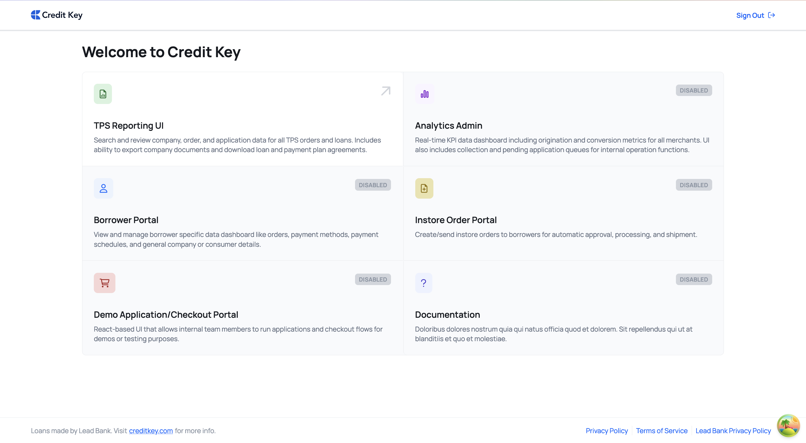

# Credit Key Frontends
[](https://nextjs.org/docs)


## Table of Contents

- [Introduction](#introduction)
- [Architecture](#architecture)
- [Installation](#installation)
- [Getting Started](#getting-started)
- [Usage](#usage)
- [Tailwind CSS Configuration](#tailwind-css-configuration)
- [SuperTokens User Management](#supertokens-user-management)
- [Screenshots](#screenshots)

## Introduction

CK Frontends is a version-controlled mono-repository that houses all Credit Key frontend UIs and shared components. It leverages the [SuperTokens](https://supertokens.com) framework for single sign-on (SSO) user authentication across all our frontend products.

## Architecture

For a comprehensive overview of the system architecture, technology stack, design patterns, and architectural decisions, please refer to the **[ARCHITECTURE.md](./ARCHITECTURE.md)** documentation.

The architecture document covers:
- System overview and application structure
- Technology stack details
- Monorepo organization and module structure
- Authentication and authorization flows
- Routing and middleware design
- State management patterns
- Data flow and API integration
- Testing strategy
- Development workflow
- Deployment architecture
- Key architectural decisions and rationale

**Note for Contributors**: When submitting PRs, please review and update ARCHITECTURE.md if your changes affect any of the areas listed above.

### Borrower Request Increase Flow

The borrower dashboard supports an in-app credit line increase flow for eligible approved company borrowers. They can enter the modal from the `Maximum Credit` stat tile on `apps/borrower/components/home/Stats.tsx` or by loading `/borrower?request_credit_increase=true`. For unauthenticated users, `middleware.ts` preserves that full borrower URL through the login redirect return target so the deep link survives auth. Once `Stats.tsx` mounts for a request-increase-eligible borrower, it auto-opens the modal once, removes `request_credit_increase` from the URL to avoid reopen loops, and then shows the same first-step modal that displays the current credit limit, collects the additional amount requested plus optional comments, and keeps `Continue` disabled until the amount is a valid positive number. Approved companies with an existing Plaid connection see a connected-bank review step where they can either continue with the existing bank to submit the request immediately or switch verification methods. Approved companies without an active bank connection go directly to the verification-method selection screen, where `Continue` routes into the real Plaid screen or a manual bank-statement upload screen. The manual path requires three selected PDF, Word, Excel, JPG, or PNG bank statement files under 10MB each and a disclaimer that the statements match the existing payment method on file. After completing Plaid verification or the manual upload step, both paths advance to an in-modal review step where the borrower must authorize a soft credit pull before the `Submit request` button is enabled; submitting then uploads each bank statement as `bank_statements` (manual path only) and calls `createLimitIncreaseRequest`. Successful Plaid, connected-bank, and manual-statement submissions remain in the modal and show an under-review confirmation with the requested increase, pending review status, and current credit limit.

**Environment Configuration:**
- The borrower request increase modal is enabled by default across all domains.
- `deploy/bin/write-build-env.sh` strips the legacy `NEXT_PUBLIC_BORROWER_REQUEST_INCREASE_MODAL_ENABLED` key from build-time env files so the retired flag is no longer exposed.

### URLs

CK Frontends uses custom middleware to dynamically route users to the appropriate UI based on subdomains for the following URLs. Users without proper permissions are redirected to an unauthorized access page.

#### Production

TPS Reporting Dashboard: [https://reports.creditkey.com](https://reports.creditkey.com)  
Borrower Portal: [https://borrower.creditkey.com](https://borrower.creditkey.com)  
Internal Admin Dashboard: [https://admin.creditkey.com](https://admin.creditkey.com)  
Instore Order Portal: [https://merchant-instore.creditkey.com](https://merchant-instore.creditkey.com)

#### Staging

TPS Reporting Dashboard: [https://staging-reports.creditkey.com](https://staging-reports.creditkey.com)  
Borrower Portal: [https://staging-borrower.creditkey.com](https://staging-borrower.creditkey.com)  
Internal Admin Dashboard: [https://staging-admin.creditkey.com](https://staging-admin.creditkey.com)  
Instore Order Portal: [https://staging-merchant-instore.creditkey.com](https://staging-merchant-instore.creditkey.com)  
Demo Checkout Store: [https://demo.creditkey.tech/](https://demo.creditkey.tech/)

#### Development (w/ Docker)

TPS Reporting Dashboard: [http://reports.creditkey.localhost](http://reports.creditkey.localhost)  
Borrower Portal: [http://borrower.creditkey.localhost](http://borrower.creditkey.localhost)  
Internal Admin Dashboard: [http://admin.creditkey.localhost](http://admin.creditkey.localhost)  
Instore Order Portal: [http://merchant-instore.creditkey.localhost](http://merchant-instore.creditkey.localhost)  
Demo Checkout Store: [http://demo.creditkey.localhost/](http://demo.creditkey.localhost/)

## Installation

Before installing make sure you are using the recommended version of Node.

You can use `nvm` as a convenience.

```bash
# Clone the repository
git clone git@github.com:creditkey/ck-frontends.git

# Navigate to the project directory
cd ck-frontends

# Set Node version
nvm use

# Install dependencies
npm install
```

### Getting Started

For CK Frontends to operation effectively, the application along with the backend server and all other necessary services should be run via their Docker containers for SuperToken cookie storage across domains to avoid CORS issues.

> **Note**: Some related repositories may be hosted on different platforms (GitHub or Bitbucket). Check each repository's actual hosting location before cloning.

```bash
# Run Clone ck-ecosystem directory and start dnsmasq and traefik
git clone git@github.com:creditkey/ck-ecosystem.git
cd ck-ecosystem
./ck-eco.sh up
```

```bash
# Clone ck-tps directory and start server
git clone git@github.com:creditkey/ck-tps.git
cd ck-tps
docker compose up -d
```

```bash
# Clone ck-web directory and start server
git clone git@github.com:creditkey/ck-web.git
cd ck-web
docker compose up -d
```

```bash
# Clone ck-auth directory and start auth server
git clone git@bitbucket.org:creditkey/ck-auth.git
cd ck-auth
docker compose up -d
```

```bash
# Clone ck-login directory and start
git clone git@github.com:creditkey/ck-login.git
cd ck-login
docker compose up -d
```

```bash
# Clone typesense directory and start
git clone git@github.com:creditkey/evenmoresql.git
cd evenmoresql
docker compose up -d
```

## Usage

### Start Application

```bash
docker compose up
```

This will start the application on `http://frontends.creditkey.localhost`.

Upon start, if user has not already been authenticated, the application will navigate to the SSO login page for two-step authentication. After authentication is complete, the auth server will automatically route user back to CK Frontends.

### Deployment environment variables

- Add `NEXT_PUBLIC_MARKET_API_URL` to each GitHub Environment (`development`, `staging`, and `production`) so deploy builds can bake Marketplace API access into the frontend bundle.

## SuperTokens User Management

Access the SuperTokens User Admin portal at: http://auth.creditkey.localhost/dashboard/

> NOTE: Contact Credit Key engineering team for login credentials and assistance managing SuperTokens users and roles

For the initial setup in your development environment, you must run this rake task to create the supertokens roles: 
```bash
rake supertokens:devsetup
```

To create a SuperTokens user via running Rails console

```bash
SuperTokens::User.create(user)
```

This should allow you to successfully login with a shared SSO cookie and access token and access approved UIs based on user permissions.

## Tailwind CSS Configuration

This project uses **Tailwind CSS v4**, which features a CSS-first configuration approach. All theme customizations are defined in `globals.css` using the `@theme` directive instead of a JavaScript configuration file.

### Key Changes in v4

- **CSS-First Configuration**: Theme tokens (colors, fonts, spacing, etc.) are now defined directly in CSS using CSS custom properties
- **No `tailwind.config.js`**: Configuration has been migrated from JavaScript to the `@theme` directive in `globals.css`
- **Updated PostCSS Plugin**: Now uses `@tailwindcss/postcss` instead of the legacy `tailwindcss` and `autoprefixer` plugins
- **Import Syntax**: Changed from `@tailwind base/components/utilities` to `@import 'tailwindcss'`

### Custom Theme Variables

All custom design tokens are defined in `globals.css`:
- **Colors**: `--color-primary`, `--color-secondary-gray`, `--color-primary-blue`, etc.
- **Fonts**: `--font-manrope`
- **Widths**: `--width-sidenav`, `--width-portal`, etc.
- **Breakpoints**: `--breakpoint-2xs`, `--breakpoint-xs`, `--breakpoint-mid`, `--breakpoint-3xl`
- **Other**: Custom max-heights, min-widths, z-index, and transition durations

**Note**: For fractional widths not in Tailwind's default scale (like 10%), use arbitrary values: `w-[10%]` instead of `w-1/10`.

For more information on Tailwind CSS v4, see the [official documentation](https://tailwindcss.com/docs).

## Screenshots

The screenshot below shows the Frontends UI Home Page, illustrating the user interface and the various accessible frontend applications.


_UIs restricted based on user roles will not be visible to all users_
